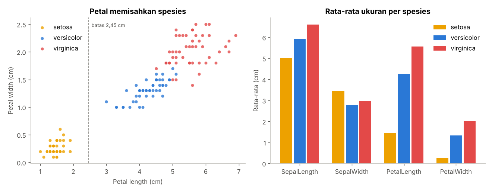
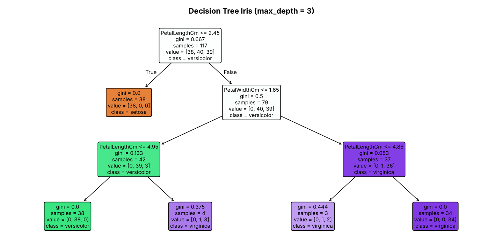
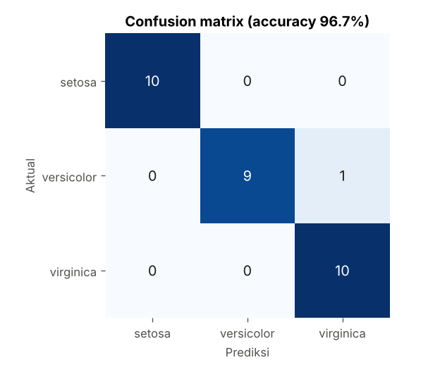

# Klasifikasi Spesies Iris dengan Decision Tree

Dataset Iris itu "Hello World"-nya Data Mining. Kecil, bersih, dan polanya jelas. Pas buat belajar alur lengkap: load data, cek kualitas, bagi train/test, latih model, lalu baca hasilnya.



## Kenapa dataset ini

- **Kecil.** 150 baris, jalan di laptop mana pun dalam hitungan detik.
- **Bersih.** Nggak ada sel kosong, semua fitur berupa angka.
- **Seimbang.** 50 bunga per spesies.
- **Tetap ada tantangannya.** Setosa gampang dipisahkan, tapi versicolor dan virginica saling tumpang tindih.

## Dataset

Satu baris = satu bunga. Sumber: UCI Machine Learning Repository via Kaggle ([Iris Species](https://www.kaggle.com/datasets/uciml/iris)).

| Kolom | Arti | Peran |
|---|---|---|
| `Id` | Nomor urut | Dibuang — cuma penanda baris |
| `SepalLengthCm` | Panjang sepal (kelopak yang menjuntai) | Fitur numerik |
| `SepalWidthCm` | Lebar sepal | Fitur numerik |
| `PetalLengthCm` | Panjang petal (kelopak tegak) | Fitur numerik |
| `PetalWidthCm` | Lebar petal | Fitur numerik |
| `Species` | `Iris-setosa`, `Iris-versicolor`, `Iris-virginica` | **Target** |

## Fitur (X) dan target (y)

Model belajar dari contoh yang jawabannya sudah diketahui. Masukannya disebut **fitur** (X), jawabannya disebut **target** (y).

Di sini X = empat ukuran kelopak, y = spesies. Kolom `Id` sengaja nggak dimasukkan ke X. Isinya unik per baris dan nggak menjelaskan apa pun soal bunganya. Kalau ikut dimasukkan, model bisa "menghafal" urutan data, bukan belajar ciri bunganya.

## Cek kualitas data

| Cek | Hasil |
|---|---|
| Null | 0 |
| Zero | 0 |
| Duplikat (tanpa kolom `Id`) | 3 baris — Id 35, 38, 143 |

Duplikat dicek tanpa `Id` karena `Id` selalu beda, jadi baris kembar nggak bakal ketahuan kalau `Id` ikut dibandingkan. Ketiga baris itu dibuang supaya nggak dapat bobot dobel. Sisa: **147 baris**.

## Train dan test

Data dibagi 80:20 pakai `train_test_split` dengan `stratify=y`, jadi proporsi tiap spesies sama di kedua bagian.

- **Train (117 baris):** dilihat model untuk membangun aturan.
- **Test (30 baris):** disembunyikan saat training, dipakai untuk mengukur seberapa bagus model menebak data baru.

Kalau model dinilai pakai data train, hasilnya bakal terlalu optimis. Model bisa saja cuma hafal.

## Cara kerja Decision Tree

Pohon keputusan bikin rangkaian pertanyaan ya/tidak soal fitur. Di tiap cabang, algoritma milih pertanyaan yang paling "membersihkan" kelompok data. Ukurannya pakai **gini**: 0 artinya satu kelompok isinya satu spesies saja.

`max_depth=3` membatasi pohon maksimal tiga tingkat. Pohon yang terlalu dalam cenderung *overfitting*: hafal data train, tapi jelek di data baru.



Aturan yang ditemukan model:

```
PetalLength <= 2.45                          -> setosa
PetalLength >  2.45 dan PetalWidth <= 1.65
    PetalLength <= 4.95                      -> versicolor
    PetalLength >  4.95                      -> virginica
PetalLength >  2.45 dan PetalWidth >  1.65   -> virginica
```

Satu pertanyaan saja (`PetalLength <= 2.45`) sudah memisahkan semua setosa. Sisanya cuma soal membedakan versicolor dan virginica.

## Hasil

**Accuracy 96,7%** — 29 dari 30 bunga di data test tebakannya benar.



| Spesies | Precision | Recall | F1 |
|---|---|---|---|
| setosa | 1,000 | 1,000 | 1,000 |
| versicolor | 1,000 | 0,900 | 0,947 |
| virginica | 0,909 | 1,000 | 0,952 |

Cara baca:

- **Confusion matrix:** baris = spesies asli, kolom = tebakan model. Angka di diagonal = tebakan benar. Satu-satunya salah: satu versicolor ditebak virginica.
- **Precision:** dari semua yang ditebak kelas X, berapa yang beneran X.
- **Recall:** dari semua yang beneran X, berapa yang berhasil ketemu.
- **F1:** rata-rata harmonis precision dan recall.

**Feature importance:** panjang petal 57,4%, lebar petal 42,6%, sepal 0%. Pohon nggak butuh ukuran sepal sama sekali.

## Batasan

- Data test cuma 30 bunga, jadi satu kesalahan saja sudah menggeser accuracy 3,3 poin. Angka ini cukup buat belajar, tapi bukan jaminan performa di data lain.
- Sampel virginica dikumpulkan di lokasi dan tahun berbeda dari dua spesies lain (Camden, Tennessee, 1926 vs Semenanjung Gaspé, 1935). Fisher sendiri sudah mengingatkan soal ini.

## Menjalankan

```bash
pip install -r ../requirements.txt
python iris_klasifikasi.py
```

Script mencetak hasil eksplorasi, evaluasi, aturan pohon, dan contoh prediksi, lalu menyimpan file ini ke `outputs/`:

| File | Isi |
|---|---|
| `ringkasan_iris.png` | Scatter petal + rata-rata ukuran per spesies |
| `confusion_matrix.png` | Confusion matrix data test |
| `decision_tree.png` | Gambar pohon keputusan |
| `decision_tree.dot` | Pohon dalam format Graphviz |
| `laporan_evaluasi.txt` | Accuracy, classification report, aturan pohon |

## Referensi

- Fisher, R.A. (1936). *The use of multiple measurements in taxonomic problems.* Annals of Eugenics, 7(2), 179–188.
- Unwin, A. & Kleinman, K. (2021). *The iris data set: In search of the source of virginica.* Significance, 18(6). https://academic.oup.com/jrssig/article/18/6/26/7038520
- Kaggle — Iris Species: https://www.kaggle.com/datasets/uciml/iris
- scikit-learn — Decision Trees: https://scikit-learn.org/stable/modules/tree.html
