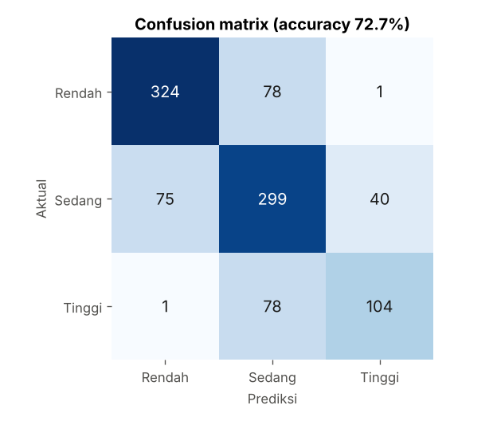
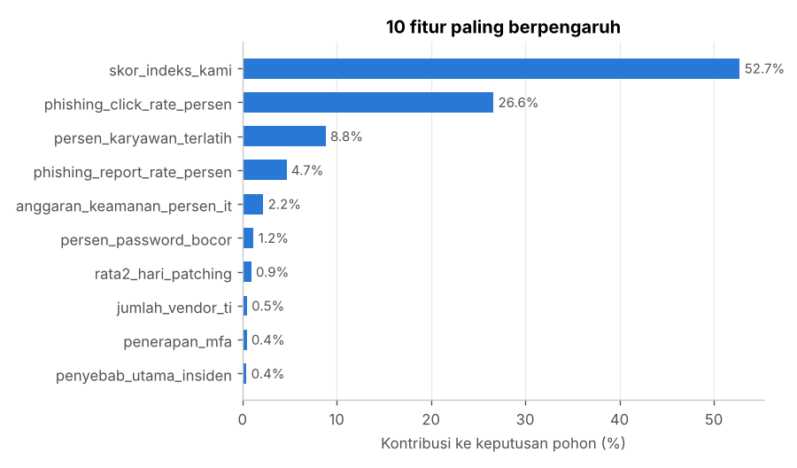

# Prediksi Security Awareness Perusahaan di Indonesia

Sebagian besar kebocoran data bukan karena sistemnya jebol, tapi karena orangnya kena tipu. Verizon DBIR 2025 mencatat faktor manusia terlibat di sekitar 60% kasus. Masalahnya, tingkat awareness karyawan susah diukur dan biasanya baru ketahuan setelah insiden.

Proyek ini mencoba menjawab dua hal:

1. Bisa nggak kita **memprediksi tingkat security awareness** perusahaan (Rendah / Sedang / Tinggi) dari profil, tata kelola, lingkungan TI, dan perilaku karyawannya?
2. Faktor apa yang paling menentukan, dan **motif serangan** apa yang paling sering menimpa perusahaan dengan awareness rendah?

> **Data sintetis.** Semua nama perusahaan, angka, dan insiden fiktif. Dataset dibuat dengan `generate_dataset.py` (seed 42). Kategori dan ambang nilainya mengacu ke regulasi dan laporan resmi (lihat [Referensi](#referensi)), tapi angkanya bukan data perusahaan nyata. Hasil analisis di sini adalah hipotesis, bukan fakta.

## Isi folder

| File | Fungsi |
|---|---|
| `data/security_awareness_indonesia.csv` | Data mentah: 5.120 baris × 55 kolom (ada duplikat, null, zero) |
| `data/security_awareness_bersih.csv` | Hasil `python sa_cli.py rapikan`: 5.000 baris |
| `01_eksplorasi_data.ipynb` | Loading 7 format (CSV, Excel, JSON, HTML, XML, SQL, GitHub), eksplorasi, perapihan, insight |
| `02_pengumpulan_data.ipynb` | Definisi kasus, sumber data, collect dari GitHub, loading pakai NumPy/pandas/scikit-learn/matplotlib, sorting kategorikal-numerikal, duplikat/null/zero |
| `klasifikasi_awareness.py` | Latih & evaluasi Decision Tree |
| `sa_cli.py` | CLI untuk cek, rapikan, ringkas, dan filter data |
| `generate_dataset.py` | Pembuat data sintetis |

## Mulai cepat

```bash
cd security-awareness
pip install -r ../requirements.txt

python sa_cli.py profil              # kondisi data mentah
python sa_cli.py rapikan             # bikin data/security_awareness_bersih.csv
python klasifikasi_awareness.py      # latih & evaluasi model
```

Buka notebook di VS Code, pilih kernel Python, lalu **Run All**. Notebook 02 mengambil data dari GitHub. Ganti `GITHUB_USER` di notebook dengan username kamu setelah repo di-push. Kalau URL belum bisa diakses, notebook otomatis pakai file lokal.

Ambil dataset langsung dari GitHub:

```python
import pandas as pd

URL = ("https://raw.githubusercontent.com/NullIvy/datamining_04TPLE001/main/"
       "security-awareness/data/security_awareness_indonesia.csv")
df = pd.read_csv(URL, dtype={"kode_pos": "string"})
```

`kode_pos` wajib dibaca sebagai teks. Isinya angka, tapi fungsinya label. Menghitung rata-rata kode pos itu nggak ada artinya.

## Dataset

Satu baris = satu perusahaan.

### Analogi Prediksi

| Kelompok | Proyek ini |
|---|---|
| Lokasi | `provinsi`, `kota`, `kode_pos`, `latitude`, `longitude` |
| Ukuran | `skala_usaha`, `jumlah_karyawan`, `omzet_tahunan_miliar_rp`, `jumlah_cabang` |
| Umur | `tahun_berdiri` |
| Kondisi | Tata kelola, lingkungan TI, perilaku karyawan |
| Riwayat | Insiden 12 bulan terakhir, motif & vektor serangan, kerugian |
| **Target** | `tingkat_awareness` (klasifikasi) / `skor_awareness` (regresi) |

### Ringkasan

| Item | Jumlah |
|---|---|
| Baris | 5.120 (5.000 perusahaan unik + 120 duplikat) |
| Kolom | 55 — 26 numerikal, 29 non-numerik |
| Duplikat | 120 baris (2,34%) |
| Null | 4.851 sel (1,72%) di 19 kolom |
| Zero | 11.758 sel di 14 kolom numerik |
| Target | Rendah 40% · Sedang 41% · Tinggi 18% |

Tiga istilah yang sering ketuker:

- **Duplikat:** baris yang muncul lebih dari sekali dengan isi persis sama.
- **Null:** sel kosong. Artinya *nggak diketahui*.
- **Zero:** sel berisi angka 0. Artinya *diketahui, dan nilainya nol*. Misalnya `jumlah_insiden_12_bulan = 0` berarti perusahaan itu memang aman setahun terakhir.

### Kamus data

| Kelompok | Kolom | Jenis | Keterangan |
|---|---|---|---|
| Identitas | `id_perusahaan`, `nama_perusahaan` | Kategorikal (identitas) | Bukan fitur |
| Lokasi | `provinsi`, `kota` | Kategorikal nominal | 20 provinsi, 43 kota |
| | `kode_pos` | Kategorikal nominal | Angka sebagai label |
| | `latitude`, `longitude` | Numerik kontinu | Sekitar pusat kota |
| Profil | `sektor`, `status_kepemilikan` | Kategorikal nominal | 13 sektor; Swasta / PMA / BUMN / Tbk |
| | `skala_usaha` | Kategorikal ordinal | Kecil / Menengah / Besar (PP 7/2021) |
| | `jumlah_karyawan`, `jumlah_cabang`, `tahun_berdiri` | Numerik diskret | |
| | `omzet_tahunan_miliar_rp` | Numerik kontinu | Konsisten dengan skala usaha |
| | `kategori_sistem_elektronik` | Kategorikal ordinal | Rendah / Tinggi / Strategis (BSSN) |
| Tata kelola | `memiliki_tim_keamanan`, `kebijakan_keamanan_tertulis`, `memiliki_dpo`, `asuransi_siber`, `program_bug_bounty` | Kategorikal biner | Ya / Tidak. DPO = pejabat pelindungan data (UU PDP) |
| | `jumlah_staf_keamanan_it` | Numerik diskret | 0 kalau nggak punya tim |
| | `memiliki_soc` | Kategorikal nominal | Internal / Outsource (MSSP) / Tidak Ada |
| | `status_iso27001` | Kategorikal ordinal | Belum / Dalam Proses / Tersertifikasi |
| | `kepatuhan_uu_pdp` | Kategorikal ordinal | Belum / Sebagian / Patuh |
| | `anggaran_keamanan_persen_it` | Numerik kontinu | % anggaran TI untuk keamanan |
| Lingkungan TI | `adopsi_cloud` | Kategorikal nominal | On-Premise / Hybrid / Cloud-First |
| | `persen_kerja_remote`, `persen_perangkat_byod` | Numerik kontinu | |
| | `jumlah_vendor_ti`, `jumlah_akun_admin`, `rata2_hari_patching` | Numerik diskret | |
| | `frekuensi_backup` | Kategorikal ordinal | Tidak Ada / Bulanan / Mingguan / Harian |
| Perilaku | `frekuensi_pelatihan_per_tahun`, `simulasi_phishing_per_tahun`, `jumlah_laporan_phishing_karyawan` | Numerik diskret | |
| | `metode_pelatihan` | Kategorikal nominal | Tatap Muka / E-Learning / Hybrid / Gamifikasi / Tidak Ada |
| | `persen_karyawan_terlatih`, `phishing_click_rate_persen`, `phishing_report_rate_persen`, `persen_password_bocor` | Numerik kontinu | |
| | `penerapan_mfa`, `kebijakan_password` | Kategorikal ordinal | |
| | `skor_indeks_kami` | Numerik diskret | 0–645 |
| | `kategori_indeks_kami` | Kategorikal ordinal | Dihitung dari skor + kategori sistem elektronik |
| Insiden | `jumlah_insiden_12_bulan` | Numerik diskret | 0 = nggak ada insiden |
| | `jenis_insiden_utama`, `motif_serangan_utama`, `vektor_serangan_awal`, `penyebab_utama_insiden` | Kategorikal nominal | "Tidak Ada" kalau nggak ada insiden |
| | `waktu_deteksi_jam` | Numerik kontinu | Kosong kalau nggak ada insiden (null struktural) |
| | `lama_downtime_jam`, `estimasi_kerugian_juta_rp` | Numerik kontinu | |
| **Target** | `skor_awareness` | Numerik kontinu | 0–100 |
| | `tingkat_awareness` | Kategorikal ordinal | Rendah (<60) / Sedang (60–79) / Tinggi (≥80) |
| Waktu | `tanggal_survei` | Tanggal | Januari–September 2026 |

Ambang Indeks KAMI mengikuti Perban BSSN No. 8 & 9 Tahun 2021:

| Kategori sistem | Tidak Layak | Pemenuhan Kerangka Kerja Dasar | Cukup Baik | Baik |
|---|---|---|---|---|
| Strategis | 0–333 | 334–535 | 536–609 | 610–645 |
| Tinggi | 0–272 | 273–455 | 456–583 | 584–645 |
| Rendah | 0–174 | 175–312 | 313–535 | 536–645 |

## Merapikan data

`sa_cli.py rapikan` dan notebook 01 pakai logika yang sama:

| Masalah | Penanganan |
|---|---|
| Duplikat | Dibuang (5.120 → 5.000 baris) |
| Null yang bisa ditebak dari logika | Nggak ada pelatihan → `metode_pelatihan = "Tidak Ada"`, `persen_karyawan_terlatih = 0`. Nggak ada insiden → kerugian = 0 |
| Null numerik | Median per kelompok (skala usaha atau sektor) |
| Null koordinat | Median koordinat perusahaan lain di kota yang sama |
| Null kategorikal | Modus per sektor; `kota` dan `kode_pos` → "Tidak Diketahui" |
| Null struktural | `waktu_deteksi_jam` dibiarkan kosong |
| Tipe data | Ordinal → `category` berurutan, nominal → `category`, Ya/Tidak → `bool`, tanggal → `datetime` |

Median dipakai, bukan rata-rata, karena kolom seperti omzet dan kerugian sangat timpang. Satu perusahaan raksasa bisa narik rata-rata jauh ke atas.

## Model: Decision Tree

### Fitur (X) dan target (y)

- **Target (y):** `tingkat_awareness`.
- **Fitur (X):** 49 kolom (25 numerik, 24 kategorikal).
- **Dibuang dari X:**
  - `id_perusahaan`, `nama_perusahaan`, `kode_pos`, `tanggal_survei` — unik per baris atau nggak relevan. Kalau dimasukkan, model cuma menghafal.
  - `skor_awareness` — ini target versi angka. Kalau ikut jadi fitur, model "nyontek" jawabannya (*target leakage*) dan accuracy-nya palsu.

### Pipeline

```
data mentah → buang duplikat → split 80:20 (stratify)
           → imputasi (median / modus) → one-hot encoding → Decision Tree
```

- Imputasi dan encoding ada **di dalam pipeline**, jadi median dan daftar kategori dihitung dari data train saja. Data test nggak ikut "bocor" ke tahap persiapan.
- `OneHotEncoder` mengubah kategori jadi kolom 0/1, misalnya `sektor_Perbankan`. Cara ini menghindari urutan palsu seperti Perbankan = 1, Fintech = 2.
- `handle_unknown="ignore"` bikin model nggak error kalau ketemu kategori baru di data test.
- `max_depth=6` dan `min_samples_leaf=20` membatasi pohon supaya nggak hafal data train.

### Hasil

Train 4.000 baris, test 1.000 baris.

| Metrik | Nilai |
|---|---|
| Accuracy | **72,7%** |
| Baseline (selalu tebak kelas terbanyak) | 41,4% |

| Kelas | Precision | Recall | F1 | Jumlah di test |
|---|---|---|---|---|
| Rendah | 0,810 | 0,804 | 0,807 | 403 |
| Sedang | 0,657 | 0,722 | 0,688 | 414 |
| Tinggi | 0,717 | 0,568 | 0,634 | 183 |



Cara baca:

- Model paling jago mengenali perusahaan dengan awareness **Rendah** (recall 80%). Ini justru kelas yang paling penting ditangkap.
- Hampir semua kesalahan terjadi antara kelas yang **bertetangga** (Rendah ↔ Sedang, Sedang ↔ Tinggi). Rendah ketuker jadi Tinggi cuma 2 kasus.
- **Tinggi** paling sering terlewat (recall 57%). Wajar, karena kelas ini paling sedikit (18%) dan batasnya dengan Sedang tipis.

### Fitur paling berpengaruh



Skor Indeks KAMI (53%) dan phishing click rate (27%) menyumbang hampir 80% keputusan pohon. Disusul persentase karyawan terlatih (9%). Artinya, kalau cuma bisa ngukur dua hal, ukur kesiapan tata kelola (Indeks KAMI) dan seberapa sering karyawan ngeklik email phishing.

## Temuan dari eksplorasi

1. **Kesenjangan sektor.** Perbankan (76) dan telekomunikasi (74) jauh di atas pendidikan (52), media (53), dan kesehatan (56). Padahal sektor kesehatan dan pendidikan pegang data pribadi sensitif.
2. **Pelatihan ngaruh.** Click rate phishing sekitar 23% di perusahaan tanpa pelatihan, turun ke sekitar 8,5% di perusahaan yang melatih karyawan 7–12 kali setahun.
3. **Faktor manusia dominan.** Kesalahan manusia jadi penyebab utama 42% insiden. Phishing jadi jenis insiden tersering (31%).
4. **Paradoks skala.** Perusahaan besar paling sadar keamanan, tapi paling sering kena insiden karena target dan sistemnya lebih banyak. Di sisi lain, 72% usaha kecil ada di level Rendah.
5. **Kesiapan regulasi rendah.** Sekitar 65% perusahaan di bawah level Cukup Baik Indeks KAMI. Sekitar 60% belum sepenuhnya patuh UU PDP.
6. **Motif beda per sektor.** Motif finansial mendominasi perbankan dan fintech. Spionase di telekomunikasi dan energi. Hacktivism di media. "Iseng" paling banyak di pendidikan.

## Pakai CLI

```bash
python sa_cli.py profil
python sa_cli.py rapikan
python sa_cli.py ringkas --by sektor
python sa_cli.py ringkas --by motif_serangan_utama --metrik estimasi_kerugian_juta_rp
python sa_cli.py cari --where "sektor == 'Kesehatan' and tingkat_awareness == 'Rendah'" \
  --kolom nama_perusahaan,kota,skor_awareness --urut skor_awareness --simpan hasil.csv
```

| Perintah | Fungsi |
|---|---|
| `profil` | Ukuran data, jenis kolom, jumlah null, zero, duplikat |
| `rapikan` | Bersihkan data mentah, simpan ke `data/security_awareness_bersih.csv` |
| `ringkas --by <kolom>` | Tabel ringkasan per kelompok |
| `cari --where "<query>"` | Filter data pakai sintaks `pandas.query` |

## Batasan

- Datanya sintetis. Pola yang ditemukan model adalah pola yang ditanam saat data dibuat, bukan bukti tentang perusahaan Indonesia.
- Model dievaluasi dari satu kali pembagian train/test. Hasil bisa sedikit beda kalau `random_state` diganti.
- Decision Tree tunggal mudah dibaca tapi bukan model paling akurat. Random Forest atau Gradient Boosting layak dicoba berikutnya.

## Referensi

1. UU Nomor 27 Tahun 2022 tentang Pelindungan Data Pribadi — https://peraturan.bpk.go.id/Details/229798
2. Peraturan BSSN Nomor 9 Tahun 2021 tentang Indeks KAMI — https://peraturan.go.id/files/bn1339-2021.pdf
3. PP Nomor 7 Tahun 2021 tentang Koperasi dan UMKM — https://peraturan.bpk.go.id/Details/161837/pp-no-7-tahun-2021
4. NIST SP 800-50 Rev. 1 (2024), *Building a Cybersecurity and Privacy Learning Program* — https://csrc.nist.gov/pubs/sp/800/50/r1/final
5. ISO/IEC 27001:2022 — https://www.iso.org/standard/27001
6. Verizon 2025 Data Breach Investigations Report — https://www.verizon.com/business/resources/reports/2025-dbir-data-breach-investigations-report.pdf
7. IBM Cost of a Data Breach Report — https://www.ibm.com/reports/data-breach
8. Kominfo-CSIRT, Laporan Tahunan Keamanan Siber 2024 — https://csirt.komdigi.go.id/storage/uploads/document_centers/attachments/Laporan%20Tahunan%20Kamsiber%202024.pdf
